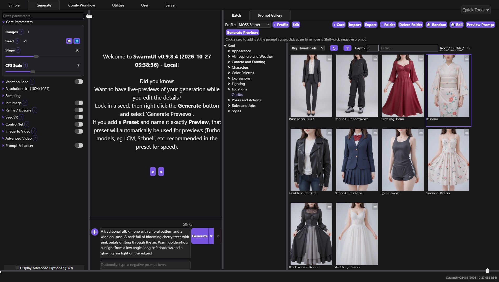
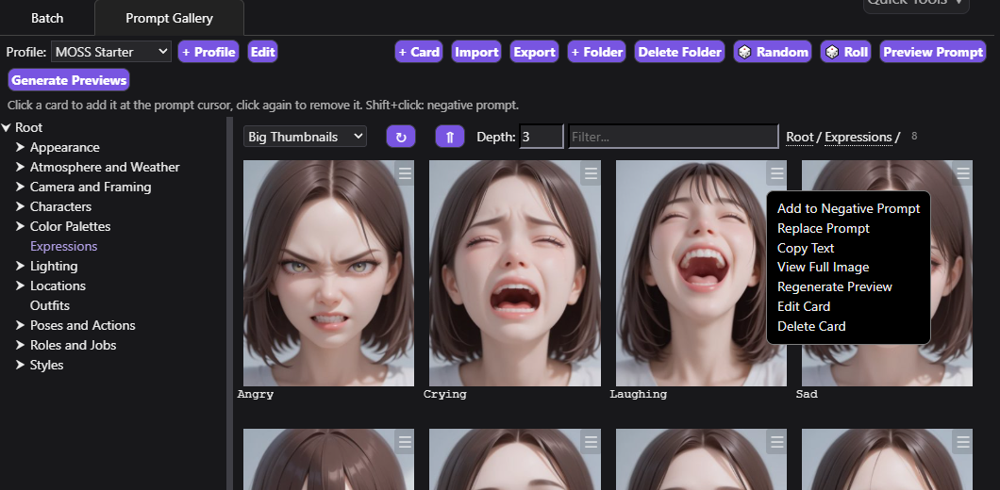
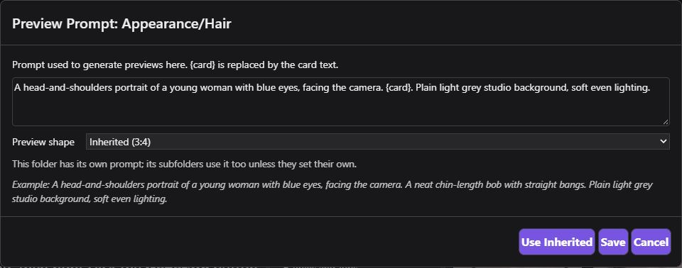
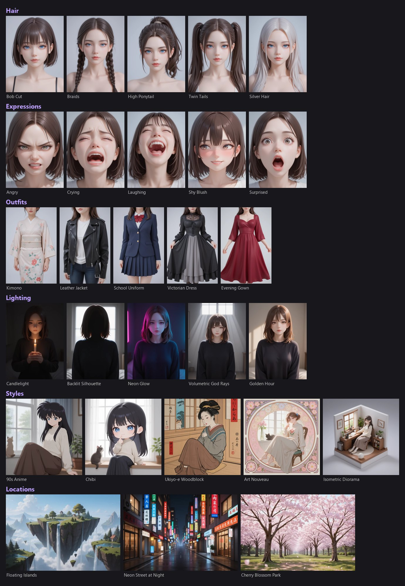

# SwarmUI Prompt Gallery

A visual library of prompt fragments for [SwarmUI](https://github.com/mcmonkeyprojects/SwarmUI).
Each card is a short piece of prompt text with a preview image, sorted into folders.
Click a card to add its text to the prompt, click it again to remove it.



Different model families want very different prompts: tag lists for SDXL-era models, prose for MOSS-Image, Flux and similar.
So cards live in **profiles**, one per model family, each with its own folders, cards and way of joining them.

The extension is built only on SwarmUI's own mechanisms (its browser, wildcards, generation API and permissions) and doesn't depend on any other extension.

## Features

### Build prompts by clicking

- **Click** a card to insert its text at the prompt cursor. **Click again** to remove it. **Shift+click** targets the negative prompt.
- Cards that are already in the prompt are highlighted, so you can see what a prompt is made of.
- Each profile sets how cards are joined: `, ` for tags, `. ` for sentences, a new line or a space.
- The card menu has **Replace Prompt**, **Copy Text**, **View Full Image** (a popup; arrow keys step through the folder), **Edit** and **Delete**.



### Previews that show what a card does

- **Generate Preview** on a card, or **Generate Previews** for a whole folder (cards without an image).
  Generation goes through SwarmUI's normal API with your current Generate settings, one image at a time, with a Stop button.
  Results are saved to the card, not to your output history.
- **Per-folder preview prompts.** `{card}` is replaced by the card text, so a hairstyle can be shown on a portrait
  (`A head-and-shoulders portrait of a young woman. {card}.`) and a location as an empty landscape.
  Subfolders inherit the prompt of their parent, and the profile has a default.
- **Per-folder preview shape**: tall 2:3 for outfits and poses, wide 3:2 for places. The pixel count stays close to your Generate resolution.
- **A fixed seed** (1 by default) makes the previews in a folder directly comparable. Previews are scaled down (512 px by default) to keep packs small.



### Organize and share

- Folder tree, search and thumbnail sizes come from SwarmUI's standard file browser. Cards without an image show a placeholder in the folder's preview shape.
- **Adding cards:** by hand (drag-and-drop, paste or "Use Current Image" for the picture), from any generated image with
  **Add to Prompt Gallery** in SwarmUI's image buttons, or by importing image files in bulk.
  The prompt is read from image metadata: SwarmUI, A1111/Forge, Fooocus and ComfyUI workflow graphs.
- **Packs** are `.zip` files with cards, previews and preview settings.
  **Export** saves the current folder or the whole profile; **Import** (or drag-and-drop) adds a pack to the current folder
  and never overwrites existing cards; **+ Profile → Start from → Pack file** makes a new profile from a pack.

### Random prompts

Every folder is kept in sync as a SwarmUI wildcard file, subfolders included.

- **🎲 Random** inserts `<wildcard:promptgallery/<profile>/<folder>>`, so each generation picks a random card from the folder.
- **🎲 Roll** inserts one random card right away. Click it again to re-roll that card in place.

### Fits anywhere

The panel is a normal SwarmUI tab: it sits next to **Batch** in the right sidebar and can be moved to the bottom bar like any built-in tab.
In a narrow sidebar the folder tree goes above the cards and rarely used buttons move into a **⋯** menu.

### MOSS-Image JSON layouts

If the prompt is a MOSS-Image JSON layout (it starts with `{`), cards are not inserted into it, since that would break the JSON.

## Starter pack

**MOSS Starter** is a ready-made profile with 160 cards and a generated preview for each one:
hair, faces, body types, expressions, outfits, poses, roles, characters, locations, weather, lighting, camera framing, color palettes and art styles.
The cards are English prose, written for MOSS-Image and other models that understand natural language.



Download `MOSS Starter.zip` from the [Releases](../../releases) page, then in the panel use **+ Profile → Start from → Pack file (.zip)**.

The previews were made with an anime-leaning MOSS-Image finetune, so they lean that way too. Regenerate any folder with your own model:
the pack brings its preview prompts, shapes and seed along.

## Install

1. Close SwarmUI.
2. Clone this repository into SwarmUI's extensions folder:
   ```bash
   cd SwarmUI/src/Extensions
   git clone https://github.com/Wanlinj1/SwarmUI-PromptGallery
   ```
3. Start SwarmUI. It compiles the extension on start, so the first start takes a little longer.
4. Open the Generate tab: **Prompt Gallery** is in the right sidebar.

Tested with SwarmUI v0.9.8.4.

To update, run `git pull` in the extension folder and restart SwarmUI. It rebuilds the extension whenever the git commit changes.

## Pack format

A pack is a `.zip` file:

```
pack.json
cards/
  Lighting/
    Golden Hour.txt      ← card text (UTF-8)
    Golden Hour.webp     ← optional preview image (png, jpg, jpeg or webp)
  Styles/Painting/
    Watercolor.txt
```

`pack.json`:

```json
{
  "format": "promptgallery-pack",
  "version": 1,
  "name": "My Pack",
  "description": "What it is for",
  "author": "",
  "separator": ". ",
  "preview_template": "{card}",
  "preview_seed": 1,
  "preview_size": 512,
  "preview_aspect": "1:1",
  "folder_templates": {
    "Lighting": "{card}. A waist-up portrait of a young woman in a simple room."
  },
  "folder_aspects": {
    "Outfits": "2:3"
  },
  "card_count": 2
}
```

- The card name is the file name. Folders become folders in the gallery.
- `folder_templates` (optional) sets preview prompts per folder. On import they never replace a prompt you already set.
- `preview_aspect` and `folder_aspects` (optional) set the preview shape: one of 1:1, 4:3, 3:2, 8:5, 16:9, 21:9, 3:4, 2:3, 5:8, 9:16, 9:21.
- `preview_seed` is -1 for a random seed; `preview_size` is the longest side of saved previews, 0 to keep the generated size.

The easiest way to make a pack is to build a profile in the UI and press **Export**.

## Where data lives

- Cards: `SwarmUI/Data/PromptGallery/<profile>/<folders>/<card>.txt`, plus an image with the same name.
  You can edit or copy these files directly. Restart SwarmUI to refresh the wildcards after editing on disk.
- Profile settings, preview prompts and shapes: `profile.json` inside each profile folder.
- Thumbnail cache: `Data/PromptGallery/.cache/`, safe to delete.
- Generated wildcards: `Data/Wildcards/promptgallery/`. The extension rewrites this folder on every change, so edit cards, not these files.

## Permissions

Two permissions appear in SwarmUI's user roles:

- `prompt_gallery_view`: browse and insert cards.
- `prompt_gallery_edit`: create, edit, delete and import (writes files on the server).

Both are on for normal users by default. Generating previews also needs SwarmUI's normal generation permissions.

## Credits

Inspired by [ComfyUI_Prompt_Gallery](https://github.com/Kinglord/ComfyUI_Prompt_Gallery) by Kinglord. The design and code here are new; no data or code was copied.

## License

[MIT](LICENSE)
